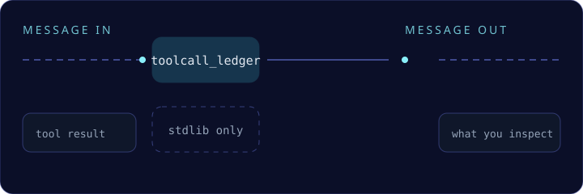

<p align="center">
  
</p>

<p align="center">
  <a href="https://pypi.org/project/toolcall-ledger/"></a>
  <a href="https://pypi.org/project/toolcall-ledger/"></a>
  <a href="https://pypi.org/project/toolcall-ledger/"></a>
  <a href="https://github.com/sandeshbagmare/toolcall-ledger/actions/workflows/ci.yml"></a>
  <a href="https://github.com/sandeshbagmare/toolcall-ledger/blob/main/LICENSE"></a>
  <a href="https://sandeshbagmare.github.io/toolcall-ledger/"></a>
  <a href="https://pypi.org/project/toolcall-ledger/"></a>
</p>

<h3 align="center">a hash-chained record of every tool call</h3>
<p align="center"><em>Standard library only. No runtime dependencies. Python 3.9+.</em></p>

<p align="center">
  
</p>

## Install

```console
pip install toolcall-ledger
```

## Use

```python
from toolcall_ledger import Ledger

ledger = Ledger("runs/today.jsonl", max_result_chars=4000)

# record what a tool returned
ledger.record("search", {"q": "python"}, result=["a", "b"], duration=0.12)

# run a call at most once per (tool, arguments)
ledger.execute("charge_card", {"id": "cus_1", "amount": 500}, charge_card)

# ask what happened
ledger.replay("charge_card", {"amount": 500, "id": "cus_1"})   # the recorded result
ledger.find("search", {"q": "python"})                          # every matching record
ledger.records[-1]                                              # the last Record
ledger.verify()                                                 # LedgerCorrupted on tampering
```

```console
$ toolcall-ledger runs/today.jsonl
   0 send_email [ok] 0.2ms 6f2c1a3e5b0d
   1 search [ok] 120.1ms 8bf5a385c929
2 record(s), chain ok

$ toolcall-ledger runs/today.jsonl --check      # exit 1 if the chain does not verify
$ toolcall-ledger runs/today.jsonl --json --tool search
```

## What goes in a record

| field | meaning |
| ----- | ------- |
| `index` | position in the chain; a gap or a reorder is detected |
| `tool`, `arguments` | the call, with secret-looking argument values masked |
| `key` | idempotency key: `sha256(tool, canonical arguments)[:32]` |
| `ok`, `result`, `error`, `duration` | the outcome |
| `at` | Unix timestamp |
| `digest` | `sha256(previous digest, canonical record)` |

Masked by default, at any depth and case-insensitively: `password`, `passwd`, `secret`,
`token`, `api_key`, `apikey`, `authorization`, `auth`, `credential`, `private`,
`session`, `cookie`. Pass `markers=(...)` for your own.

## Rules

- The chain detects an **edit**, a **reorder** or a changed index. Removing lines from
  the end of a file is indistinguishable from a shorter run — keep the file somewhere
  append-only (a bucket with object-lock, or a store with retention) if that matters.
- `execute` treats "no earlier successful call" and "an earlier call returned `None`" the
  same way, so a tool returning `None` is not memoised. Return a small marker instead.
- Results longer than `max_result_chars` are truncated with a marker; the digests still
  cover the truncated text.
- Argument canonicalisation is JSON: dict order does not matter, a `datetime` or an
  object is stored as `repr`. Normalise exotic arguments yourself if you need stability.

## Why not just a log file

A plain JSONL log answers "what happened". This one answers "what happened, in this
order, and has anything been changed since". That is the difference between a debugging
aid and an audit trail you can hand to someone.

## Development

```console
python -m venv .venv
.venv/bin/pip install -e ".[test]"
.venv/bin/pytest
```

## License

MIT.
